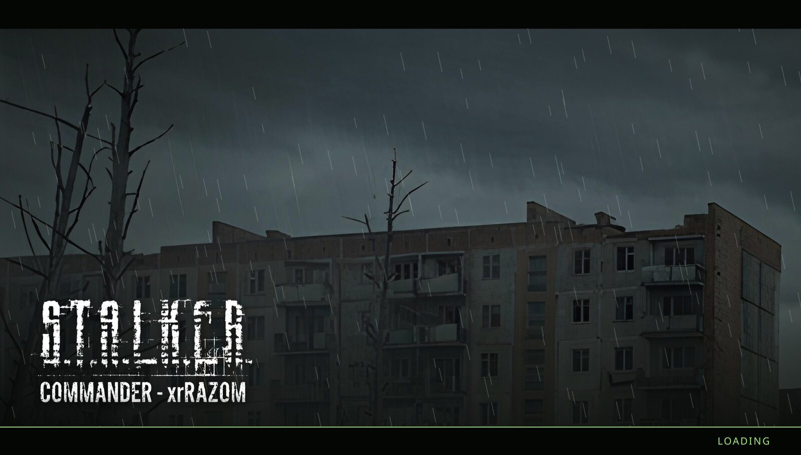
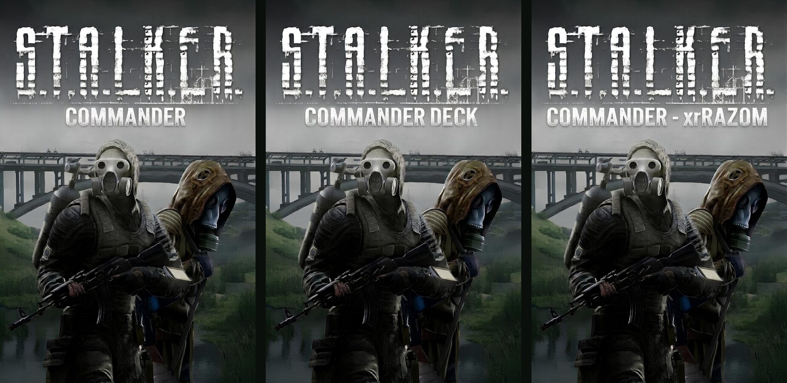
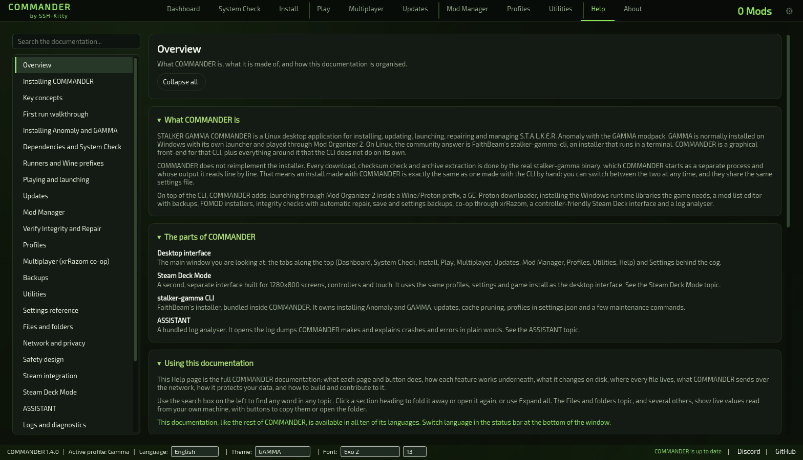
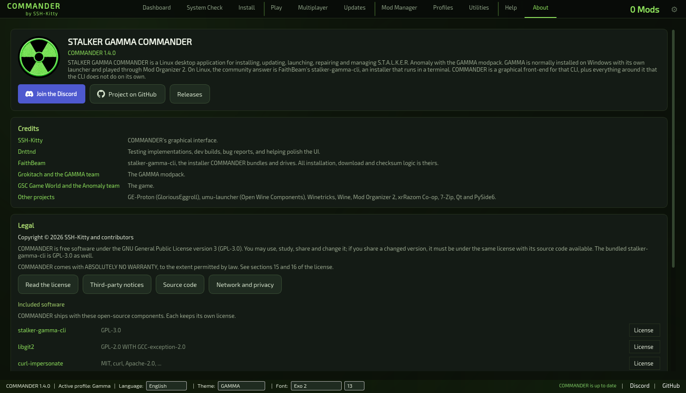

<div align="center">

<a></a>

<br>

<a href="https://github.com/SSH-Kitty/STALKER-GAMMA-COMMANDER/releases"></a>
<a href="https://github.com/SSH-Kitty/STALKER-GAMMA-COMMANDER/releases/latest"></a>
<a href="#getting-the-unstable-build"></a>
<a href="LICENSE"></a>

<br>

<a href="https://github.com/SSH-Kitty/STALKER-GAMMA-COMMANDER/releases"></a>
&nbsp;
<a href="https://discord.gg/6A9psrtYhh"></a>

### COMMANDER 1.4.0 · Unstable build

Early builds of the next COMMANDER release, published for testing before they reach the stable channel.

<a href="#whats-new-in-140"><b>What's new</b></a> ·
<a href="#getting-the-unstable-build">Getting the build</a> ·
<a href="#feedback">Feedback</a> ·
<a href="https://github.com/SSH-Kitty/STALKER-GAMMA-COMMANDER">Stable release and full documentation</a>

</div>

> [!WARNING]
> **Unstable builds are pre-release software.** They receive new features first, are less thoroughly tested and may
> contain defects. For everyday play, use the
> [latest stable release](https://github.com/SSH-Kitty/STALKER-GAMMA-COMMANDER/releases/latest). You can return to the
> stable build at any time under **Settings → General → COMMANDER build**.

<br>

<a></a>

## About this branch

This is the `1.4.0-Unstable` branch, the source of COMMANDER's unstable builds. Each build is published as a
pre-release on this repository's [Releases](https://github.com/SSH-Kitty/STALKER-GAMMA-COMMANDER/releases) page, next to
the stable releases. COMMANDER's unstable update channel and the **Try the unstable build** button in Settings both read
from those pre-releases.

The notes below describe what this build adds compared with the latest stable release, **1.3.1**. For the complete
feature overview, installation guide and Steam Deck documentation, see the
[main README](https://github.com/SSH-Kitty/STALKER-GAMMA-COMMANDER/tree/main#readme).

<a id="whats-new-in-140"></a>
<a></a>

<table>
<tr>
<td width="33%" valign="top">
<a></a><br>
<b>Multiplayer</b><br>
xrRazom co-op support with a dedicated page, one-step switching between co-op and singleplayer, and its own Steam
shortcut and loading screen.
</td>
<td width="33%" valign="top">
<a></a><br>
<b>Redesigned Updates page</b><br>
Patch notes for every release you have not installed yet, a clear list of mod changes, and support for GOG
installations.
</td>
<td width="33%" valign="top">
<a></a><br>
<b>Your setup survives updates</b><br>
Custom mods, enabled and disabled choices, MO2 settings and launch arguments are restored after every install and
update.
</td>
</tr>
<tr>
<td valign="top">
<a></a><br>
<b>Better launching</b><br>
Steam-style launch options with <code>%command%</code>, quick toggles, crash loop detection and one-click crash
analysis.
</td>
<td valign="top">
<a></a><br>
<b>Steam library artwork</b><br>
Add to Steam now installs cover art, a background, a logo and a wide cover for every COMMANDER shortcut.
</td>
<td valign="top">
<a></a><br>
<b>Built-in documentation</b><br>
A new Help page documents every page and control, and a new About page lists credits and licences.
</td>
</tr>
</table>

### Multiplayer: xrRazom co-op


The new **Multiplayer** page installs [xrRazom Co-op](https://www.moddb.com/mods/xrrazom-stalker-anomaly-co-op) (Slim edition) and manages it alongside
your singleplayer installation.

- **Guided installation.** Download the xrRazom archive from moddb; COMMANDER finds the newest copy in your Downloads
  folder or on the Desktop and installs it.
- **Two components, managed separately.** The engine executables, Steam networking DLLs and loose files are kept in
  `<anomaly>/commander-coop/files`, and every original file they replace is backed up to
  `<anomaly>/commander-coop/backup`. The `gamedata/` component is installed as a regular MO2 mod, **xrRazom Co-op**, at
  the highest priority.
- **One-step switching.** **Switch to co-op** backs up the affected Anomaly files, copies in the co-op files and enables
  the mod. **Switch to Singleplayer** restores the originals and disables the mod. Co-op saves are kept.
- **Safe launches.** While co-op is active, only co-op can be launched, and vice versa. Updates and repairs ask you to
  return to singleplayer first; if an update replaces the engine, **Re-apply co-op** restores the co-op files.
- **Steam or LAN.** Steam sessions use Steam invites through Call of Pripyat (app 41700) when it is owned, or Spacewar
  (app 480) otherwise. COMMANDER creates the co-op Steam shortcut with the correct compatibility tool and artwork. LAN
  sessions use an IP address and port (27015 by default).
- **Host settings.** Player slots, friendly fire, rescue, saving, teleport and fast travel are stored as the mod's
  `xrr_*` variables in `user.ltx`. COMMANDER changes only those lines.
- **Stream-friendly.** Your LAN address is blurred on the invite tab. Your public address is looked up only when you
  ask for it.

#### Co-op loading screen



Co-op launches replace the engine's built-in splash with a COMMANDER loading screen in the theme's accent colour. It
closes as soon as the engine reports that it has started. Singleplayer keeps GAMMA's own splash, because its engine
cannot turn it off.

### Redesigned Updates page


- **Every release you have missed.** GAMMA's patch notes are listed newest first, and releases you have not installed
  yet are marked **New**. Each entry can be expanded or collapsed.
- **Clear mod changes.** Every added, removed and changed addon is listed with the kind of change. If nothing differs,
  the page says your mod list matches the official one.
- **Before you update.** Installed and latest versions, free space on the drive that holds your download cache, and
  **Keep my settings** are shown together. **Install updates** states how many updates will be applied.
- **GOG installations.** GOG and manual installs do not include GAMMA's modpack list. COMMANDER now rebuilds it from
  the mods actually present, so update checks work. Mods that cannot be confirmed are reinstalled with the next update.

### Your setup survives installs and updates

GAMMA's installer replaces several files that belong to you. COMMANDER now takes a snapshot before each install or
update and puts it back once the job succeeds:

- **`modlist.txt`.** Your enabled and disabled choices are re-applied, and your own mods are re-added under
  **Custom Mods**, as long as their folders still exist.
- **`ModOrganizer.ini`.** MO2's own settings and theme, the executable selected in MO2, and each executable's
  arguments (for example DX11 instead of DX11-AVX, or `-dbg`).
- **Engine executables**, when the new **Keep my current engine executables** option is enabled.

New install options:

| Option | What it does |
|---|---|
| **Re-download GitHub addons** | By default, GitHub-hosted archives are now reused from the cache instead of being downloaded again on every install. Tick this to fetch them anyway. |
| **Keep my current engine executables** | Keeps engine executables you installed yourself, such as newer or modded builds, instead of replacing them with GAMMA's. |

### Better launching

- **Steam-style launch options.** `NAME=value` sets an environment variable, words before `%command%` wrap the game
  (for example `mangohud %command%`), and words after it are passed to the game.
- **Quick toggles** for MangoHud, an FPS counter, and disabling Esync or Fsync.
- **Crash loop detection.** If Wine starts crashing repeatedly, the launch is stopped before it exhausts system memory.
- **Analyze crash.** When Anomaly writes a crash log, COMMANDER offers to create a log dump and open it in ASSISTANT.

### Steam library artwork



**Add COMMANDER to Steam** now installs a cover, a background, a logo and a wide cover for **STALKER COMMANDER** and
**STALKER COMMANDER DECK**, and the co-op shortcut gets its own set and icon.

### Built-in documentation

<table>
<tr>
<td width="50%"><a href="docs/readme/unstable/help.png"></a><br><sub>Help: the complete COMMANDER documentation</sub></td>
<td width="50%"><a href="docs/readme/unstable/about.png"></a><br><sub>About: credits, licences and included software</sub></td>
</tr>
</table>

- **Help** is a complete, searchable manual covering 27 topics. It explains every page and control, what each action
  changes on disk, where every file is stored, and all network activity. Some topics show live paths from your own
  system, with buttons to copy or open them. It is available in all ten languages.
- **About** shows the version, credits and licence, and lists every bundled open-source component with its licence
  text, readable offline.

### Stable and unstable builds

**Settings → General → COMMANDER build** shows which build you are running. On a stable build, **Try the unstable
build** appears when an unstable build newer than the latest stable release is available. On an unstable build, **Go
back to the stable build** installs the latest stable release, even when its version number is lower.

### Also in this build

- The bundled [stalker-gamma-cli](https://github.com/FaithBeam/stalker-gamma-cli) has been updated from **1.36.1** to
  **1.38.0**.
- **Resume picks up where it stopped**: *Resume GAMMA Installation* (and *Resume install* in Deck Mode) now uses the
  CLI's `--resume`, so mods that were already installed are skipped instead of unpacked again. A failed or cancelled
  update shows **Resume update** on the Updates page and in Deck Mode, which does the same for `update apply`.
- Stopping an update, Verify Integrity, a mod install or a Proton download now asks first, so a stray click doesn't
  throw away progress.
- The AppImage now bundles Python 3.12.15.
- **Offline install**: download the offline cache archive, extract it into the folder that contains your cache folder,
  then tick *Offline install (cache only)* on the Install page (or in Deck Mode). The `modlist.txt` and
  `modpack_maker_list.txt` inside the archive are found automatically. This installs GAMMA without downloading anything. See the CLI's
  [Offline Install guide](https://github.com/FaithBeam/stalker-gamma-cli/wiki/Offline-Install).
- The COMMANDER ASSISTANT log analyser has been revised throughout, with clearer findings for launcher, MO2, CLI and
  engine logs.
- The Install, Play, Mod Manager, Profiles and Settings pages have been reworked, and the themes have been refined.

<a id="getting-the-unstable-build"></a>
<a></a>

### From COMMANDER (recommended)

Open **Settings → General → COMMANDER build** and select **Try the unstable build**. COMMANDER downloads the build,
replaces itself and restarts. From then on, it updates to newer unstable builds and to the stable release that
supersedes them. This requires the AppImage and COMMANDER 1.4.0 or later.

### AppImage

Download the latest unstable `.AppImage` (marked *Pre-release*) from
[**Releases**](https://github.com/SSH-Kitty/STALKER-GAMMA-COMMANDER/releases):

```bash
chmod +x STALKER-GAMMA-COMMANDER-*-unstable*-x86_64.AppImage
./STALKER-GAMMA-COMMANDER-*-unstable*-x86_64.AppImage
```

Each release includes a `.sha512sum` file for verifying the download.

### From source

```bash
git clone -b 1.4.0-Unstable https://github.com/SSH-Kitty/STALKER-GAMMA-COMMANDER.git
cd STALKER-GAMMA-COMMANDER
./run.sh
```

`run.sh` creates a virtual environment in `.venv/`, installs PySide6 and starts COMMANDER. Pass `--deck` to start in
Steam Deck Mode. The AUR package follows stable releases only.

<a id="feedback"></a>
<a></a>

Testing unstable builds is the most useful way to help before a release. When reporting a problem:

1. Include the exact build number, shown under **Settings → General → COMMANDER build** and in the status bar.
2. Create a log dump with **Utilities → Create Log Dump** and attach it.
3. Report it in the [Discord](https://discord.gg/6A9psrtYhh) or as an
   [issue](https://github.com/SSH-Kitty/STALKER-GAMMA-COMMANDER/issues), with "unstable" in the
   title.

<a></a>

- **[FaithBeam](https://github.com/FaithBeam)**: [`stalker-gamma-cli`](https://github.com/FaithBeam/stalker-gamma-cli),
  the installer that COMMANDER bundles and runs.
- **[dnttnd](https://github.com/dnttnd)**: testing, development builds, bug reports and UI refinement.
- **Harbingerr**: xrRazom Co-op, the multiplayer mod.
- **[Grokitach](https://github.com/Grokitach)** and the GAMMA team: [the modpack itself](https://github.com/Grokitach/Stalker_GAMMA).
- **The Anomaly Team**: developers of the standalone S.T.A.L.K.E.R. Anomaly modification and engine base.
- **[GSC Game World](https://www.gsc-game.com/)**: creators of the original S.T.A.L.K.E.R. games and universe.

<a></a>

Licensed under the **GNU General Public License v3.0**; see [LICENSE](LICENSE). COMMANDER bundles and runs
`stalker-gamma-cli`, which is licensed under GPL-3.0, and is therefore distributed under the same licence.

<div align="center">

<a></a>

<sub>S.T.A.L.K.E.R. G.A.M.M.A. COMMANDER · Unstable channel</sub><br>
<sub>Not affiliated with GSC Game World or the GAMMA development team.</sub><br>
<sub><i>Good hunting, stalker.</i></sub>

</div>
