<div align="center">


<br>

<a href="https://github.com/SSH-Kitty/STALKER-GAMMA-COMMANDER/releases"></a>
<a href="https://github.com/SSH-Kitty/STALKER-GAMMA-COMMANDER/releases/latest"></a>
<a href="#install"></a>
<a href="LICENSE"></a>

<br>

<a href="https://github.com/SSH-Kitty/STALKER-GAMMA-COMMANDER/releases/latest"></a>
&nbsp;
<a href="https://discord.gg/6A9psrtYhh"></a>

### Get into the Zone without touching a terminal

Install, update, mod and launch S.T.A.L.K.E.R. Anomaly with the GAMMA modpack on Linux and Steam Deck.<br>
Progress tables, a mod manager, Proton handling, co-op and a Play button, all in one window.

<a href="https://github.com/SSH-Kitty/STALKER-GAMMA-COMMANDER/releases"><b>Download</b></a> ·
<a href="#whats-new-in-140">What's new</a> ·
<a href="#features">Features</a> ·
<a href="#install">Install</a> ·
<a href="#first-run">First run</a> ·
<a href="#steam-deck-mode">Steam Deck</a> ·
<a href="https://github.com/SSH-Kitty/STALKER-GAMMA-COMMANDER/issues">Report a bug</a>

<br>

<a href="docs/readme/screens/dashboard.png">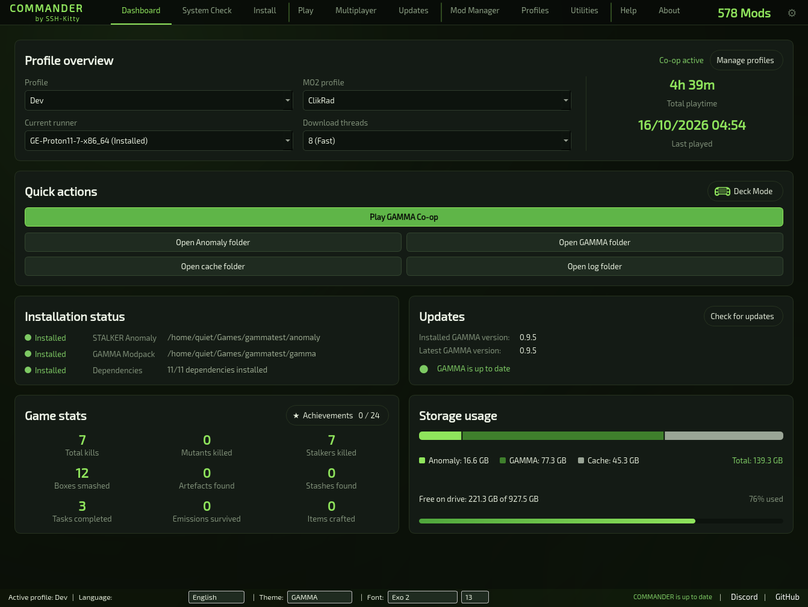</a>

<sub>The Dashboard: profile, install status, dependencies, storage, playtime and updates at a glance.</sub>

</div>

> [!WARNING]
> **You are on the `1.4.0-Unstable` branch.** Unstable builds get new features first and may have bugs. For the
> tested version, use the [latest stable release](https://github.com/SSH-Kitty/STALKER-GAMMA-COMMANDER/releases/latest).
> You can switch between stable and unstable at any time in **Settings → COMMANDER build**.

<br>


## What this is

GAMMA is a huge S.T.A.L.K.E.R. Anomaly modpack, normally installed through a Windows launcher and run through Mod
Organizer 2. On Linux, the community solution is [FaithBeam/stalker-gamma-cli](https://github.com/FaithBeam/stalker-gamma-cli),
an excellent but entirely terminal-driven installer.

**COMMANDER is a desktop GUI around that CLI.** It doesn't reimplement any installer logic: it drives the real
`stalker-gamma` binary and reads its output live. Every download, checksum and extraction is done by the upstream CLI,
so the result is identical to using it by hand. You just get progress tables, a mod manager, prefix handling and a Play
button instead of a terminal.

On top of the CLI, COMMANDER adds what it doesn't do on its own: launching through Mod Organizer 2 in a Wine/Proton
prefix, a GE-Proton installer, a `modlist.txt` editor, dependency setup, co-op through xrRazom, save and settings
backups, and a full integrity check and repair pass.

<a id="whats-new-in-140"></a>


<table>
<tr>
<td width="33%" valign="top">
<br>
<b>Multiplayer: xrRazom co-op</b><br>
A new Multiplayer page installs xrRazom Co-op (Slim) from the zip you downloaded, and switches between co-op and
singleplayer in one click. Every original file is backed up, so singleplayer can always be restored.
</td>
<td width="33%" valign="top">
<br>
<b>Stable or unstable builds</b><br>
Choose your COMMANDER build in Settings. Unstable follows pre-releases like this one; switching back installs the newest
stable release, even if it is older.
</td>
<td width="33%" valign="top">
<br>
<b>A real Help page</b><br>
Full documentation inside the app: what every page and button does, what changes on disk, where each file lives and
what COMMANDER sends over the network.
</td>
</tr>
</table>

<details>
<summary><b>How co-op works</b></summary>
<br>

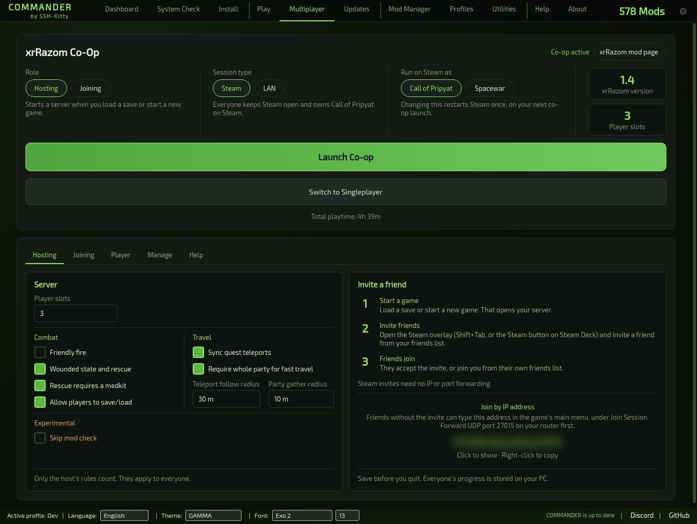

- **Two halves, handled separately.** The Anomaly part (engine exes, Steam networking DLLs, loose files) is kept in
  `<anomaly>/commander-coop/files`, and every original it replaces in `<anomaly>/commander-coop/backup`. The
  `gamedata/` part becomes an ordinary MO2 mod, **xrRazom Co-op**, at the highest priority.
- **Switch to co-op** backs up the Anomaly folder, copies the co-op files in and enables the mod. **Switch to
  Singleplayer** puts the originals back and disables the mod. Your co-op saves are kept.
- **Launches are checked.** With co-op on, only co-op can be launched; with it off, only singleplayer. Updates and repairs
  ask you to switch back first, and **Re-apply co-op** fixes things if an update restored the original engine.
- **Steam or LAN.** Steam sessions use Steam invites through Call of Pripyat (app 41700) if you own it, otherwise
  Spacewar (app 480). COMMANDER writes the co-op shortcut into Steam with the right compatibility tool and artwork.
  LAN sessions use an IP address and port (27015 by default).
- **Settings** are the mod's `xrr_*` variables in `user.ltx`. COMMANDER changes only those lines. Only the host's rules
  count: player slots, friendly fire, rescue, saving, teleport and fast travel.

xrRazom Co-op is a separate mod by its own authors. Close the game before changing any co-op setting.

</details>

<a id="features"></a>
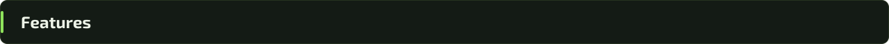

<table>
<tr>
<td width="33%" valign="top">
<br>
<b>Dashboard</b><br>
Active profile, install status, live dependency count, storage use, playtime and a background check for GAMMA updates.
</td>
<td width="33%" valign="top">
<br>
<b>Install</b><br>
Anomaly and GAMMA with a live per-addon progress table, resume after an interruption, and Minimal mode to save ~50 GB.
</td>
<td width="33%" valign="top">
<br>
<b>Play</b><br>
Launch through MO2 with the newest GE-Proton picked for you, per-runner prefixes, and crash diagnosis by name.
</td>
</tr>
<tr>
<td valign="top">
<br>
<b>Updates</b><br>
See exactly which addons were added, modified or removed, apply them with live progress, and undo the last update.
</td>
<td valign="top">
<br>
<b>Mod Manager</b><br>
Search, toggle, drag to reorder and install your own mods (FOMOD too). Writes are atomic and backed up first.
</td>
<td valign="top">
<br>
<b>Verify and repair</b><br>
A full MD5 scan of every mod, and non-destructive repair that redownloads only what is broken.
</td>
</tr>
<tr>
<td valign="top">
<br>
<b>Profiles</b><br>
Several installs side by side, each with its own folders, MO2 profile and repositories. Export and import them.
</td>
<td valign="top">
<br>
<b>System Check</b><br>
Every dependency GAMMA and MO2 need, in one place, with a copyable install command for your distro.
</td>
<td valign="top">
<br>
<b>Utilities</b><br>
Cache cleanup, prefix repair, moving an install to another drive, log dumps and guarded resets.
</td>
</tr>
<tr>
<td valign="top">
<br>
<b>Saves and settings backups</b><br>
Saves, <code>user.ltx</code> and MCM settings are backed up before every reset, update and repair, outside every install folder.
</td>
<td valign="top">
<br>
<b>Steam Deck Mode</b><br>
A second interface built for the Deck's screen, controller and touchscreen. Works in Game Mode.
</td>
<td valign="top">
<br>
<b>10 languages, 6 themes</b><br>
Switch language and theme instantly, no restart. Fonts and sizes are yours to pick.
</td>
</tr>
</table>

**Also included:** achievements and game stats, Discord Rich Presence (off by default), desktop shortcuts per launch
target, **Add to Steam** in one click, the bundled COMMANDER ASSISTANT log analyser, and automatic updates of COMMANDER
itself in the AppImage.

<details>
<summary><b>Dashboard</b></summary>
<br>

The landing page. Shows the active profile, install status for Anomaly and GAMMA, a live dependency count, storage usage
across your Anomaly, GAMMA and cache folders, and a background check for GAMMA addon updates. Quick-open buttons jump
straight to the Anomaly, GAMMA, cache and log folders, and a **Play GAMMA** shortcut launches the game without leaving
the page. Total playtime is tracked per profile, and the Game stats card opens your achievements.

</details>

<details>
<summary><b>Install</b></summary>
<br>

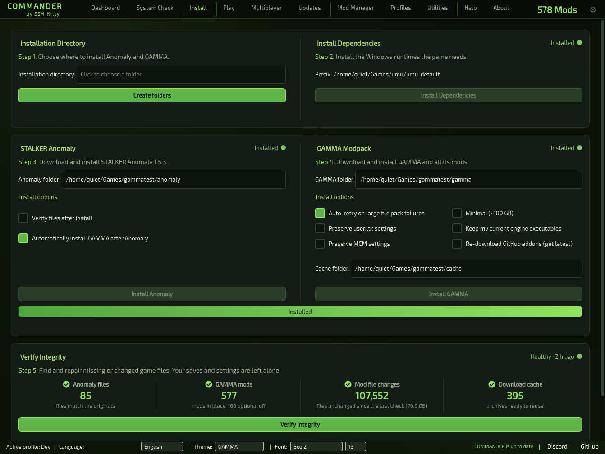

Installs S.T.A.L.K.E.R. Anomaly and GAMMA with a **live per-addon progress table** (name, operation, percent) and an
overall completion bar. Pick a base folder and press **Create folders** to generate the Anomaly, GAMMA and cache layout.

- If a download is interrupted, the next launch offers **Resume GAMMA Installation**. Cached archives are hash-verified
  and reused; only missing or changed ones are downloaded again.
- **Minimal mode** deletes addon archives after extraction to save ~50 GB of disk space.
- **Preserve user.ltx** and **Preserve MCM settings** protect your keybindings, game options and mod configs across a
  reinstall.
- **Install Dependencies** sets up everything MO2 and the game need in one click: `umu-run`, `protontricks` (via `pipx`
  on PEP 668 systems), and eight Visual C++/DirectX runtimes (`d3dcompiler_43`, `d3dcompiler_47`, `d3dx10`,
  `d3dx11_43`, `d3dx9`, `quartz`, `dx8vb`, `vcrun2022`). They are installed through the selected runner's own Wine
  (`umu-run winetricks` for GE-Proton, the runner's `wine` binary otherwise), never the system `winetricks` or `wine`.
  Running a different Wine build against a Proton prefix corrupts its system DLLs and makes the game crash-loop on
  launch, so COMMANDER refuses to do that.

</details>

<details>
<summary><b>Play</b></summary>
<br>

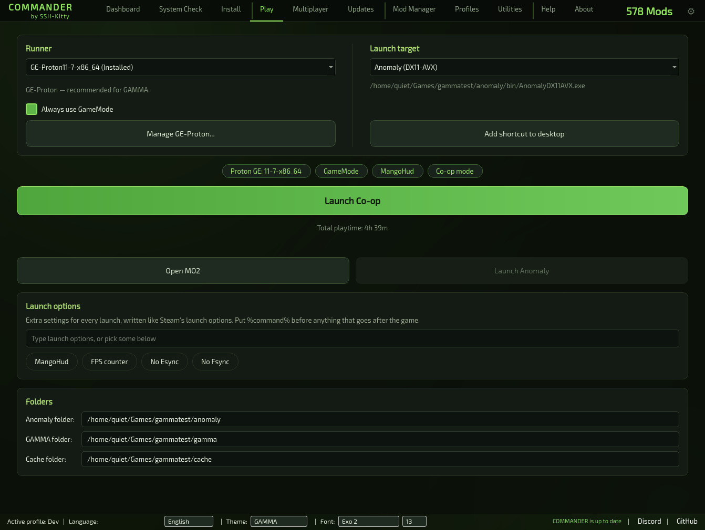

Launch GAMMA through Mod Organizer 2, open MO2 directly, or run Anomaly's executable without MO2's virtual file system.
Targets are read straight from `ModOrganizer.ini`, with `AnomalyLauncher.exe` as a fallback.

- **Automatic runner detection.** The newest installed GE-Proton build is picked and launched through `umu-run`.
- **Built-in GE-Proton installer.** Browse recent releases, download with a progress bar, and COMMANDER verifies the
  SHA-512 checksum and installs it into `compatibilitytools.d` for you.
- **Per-runner prefixes.** Each runner keeps its own Wine prefix, so switching runners never corrupts a prefix built by
  a different version.
- A live command preview with a copy button, a custom launch options field (supports variables like
  `PROTON_USE_WINED3D=1`), and status chips for installed GE-Proton builds, GameMode and MangoHud.
- The game launches **detached**, so closing COMMANDER doesn't end your session. Output goes to a rotating
  `launcher.log`. Failed launches are diagnosed: a DXVK/Vulkan problem, a runner/prefix mismatch or the classic
  `concrt140.dll` error is called out by name, with a one-click bug report.
- One-click **desktop shortcuts** for a specific target with the current runner.
- Optional **Discord Rich Presence** ("Playing S.T.A.L.K.E.R. GAMMA" with your mod count and playtime). Off by
  default; one checkbox in Settings turns it on.

</details>

<details>
<summary><b>Updates</b></summary>
<br>

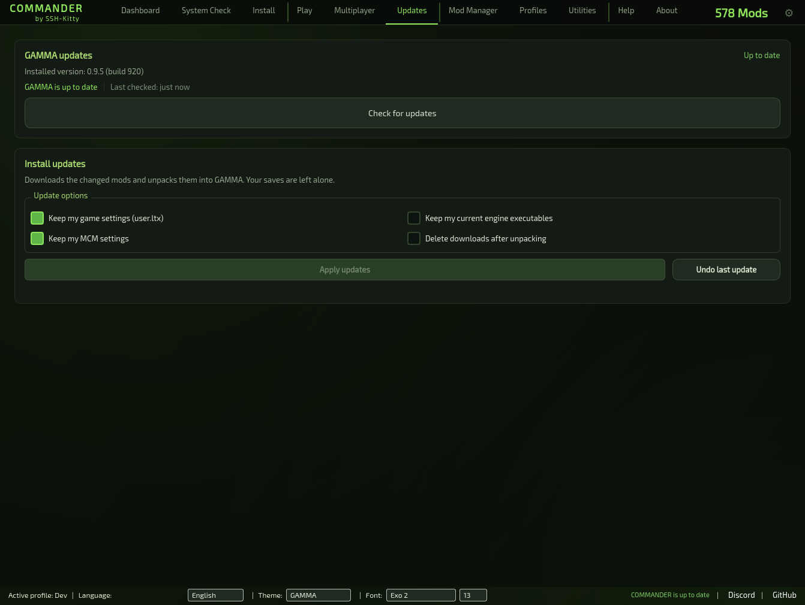

Compares your installed GAMMA version and addon list with the latest official data, without hitting the rate-limited
GitHub REST API, and shows exactly what changed: added, modified, removed, and renamed archives.

Applying updates uses the same live progress as a fresh install, respects the Minimal and preserve-settings options,
and holds the global install lock so it can never run alongside another install. A **background check runs at most
once a day** even if you never open this page, with a desktop notification when one is found. If an update goes wrong,
**Undo Last Update** restores the `modlist.txt` snapshot taken right before it.

</details>

<details>
<summary><b>Mod Manager</b></summary>
<br>

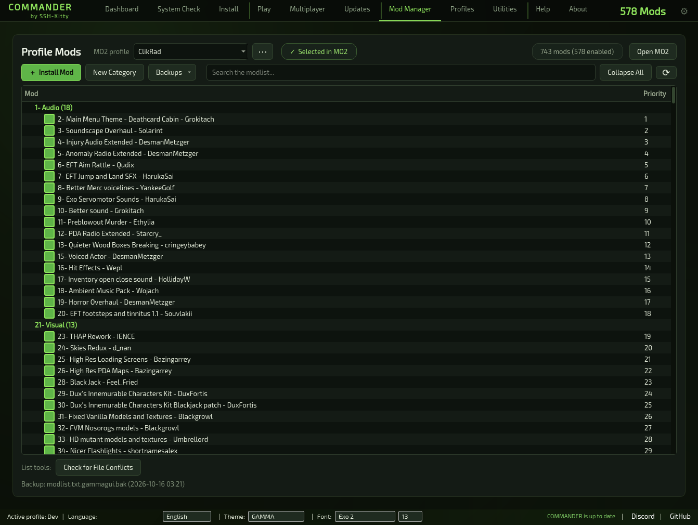

Careful editing of the active MO2 profile's `modlist.txt`: search, enable, disable, delete and reorder mods, grouped by
the `_separator` categories GAMMA ships.

- **Drag-and-drop reordering** with multi-selection, plus Move Up and Move Down.
- **Reversed load order detection.** A GAMMA load order flipped end to end (which crashes the game on startup) is
  flagged here and before launching, with a one-click fix.
- Create categories, install a local ZIP/7Z/RAR/FOMOD archive straight into the mod list, and set the active profile as
  MO2's selected profile without opening MO2.
- **A backup is taken before your first edit** and can be restored from the Backups menu, next to **Restore Original
  Order**, which puts GAMMA's mods back in GAMMA's order and keeps your own.
- **Writes are atomic**, so a crash or a full disk can't truncate your load order, and **edits are blocked while Mod
  Organizer is running**, since MO2 rewrites the file on exit.
- **Check for File Conflicts** lists files shared by more than one enabled mod, so you see what actually overrides what.
- Press **Ctrl+F** anywhere to jump to this page's search box.

</details>

<details>
<summary><b>Verify Integrity and Repair</b></summary>
<br>

Runs three passes: an Anomaly file check, a GAMMA presence check (every enabled mod must exist on disk), and a full MD5
scan of every file under `gamma/mods` against a saved baseline. Anything missing, corrupted or changed is reported.

If a broken mod matches the official GAMMA mod list, COMMANDER can **repair it automatically and non-destructively**: the
mod folder and its cached archive are set aside (not deleted), then it's downloaded again and MD5-verified against the
official checksum. If the repair fails or is cancelled, the set-aside copies are restored. Your own mods are never
touched, and anything with no known download source is reported instead.

</details>

<details>
<summary><b>Profiles</b></summary>
<br>

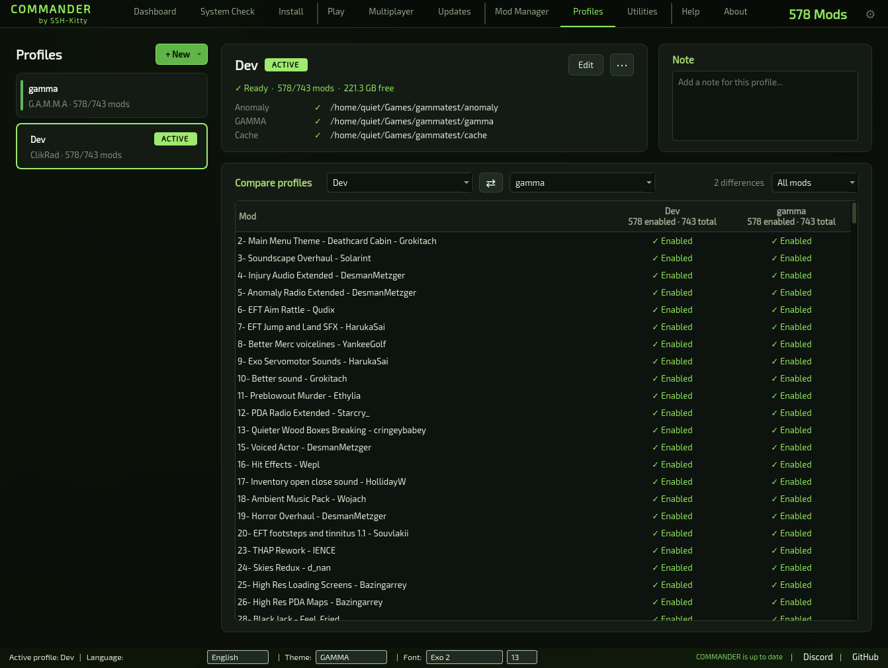

Create, edit, activate and delete CLI profiles, each with its own Anomaly, GAMMA, cache, MO2 profile, download-thread
and repository settings. Creating, activating and deleting go through `stalker-gamma config`, so its side effects
(MO2's `selected_profile`, mod list downloads) happen exactly as the CLI intends. Advanced fields expose every repository
URL and branch the CLI supports, for forks and mirrors.

**Export and Import Profile** save a profile's portable settings (and its `modlist.txt`, if installed) to a file you can
back up or share. Install folders are always chosen fresh on import, since they're specific to each machine.

</details>

<details>
<summary><b>System Check</b></summary>
<br>

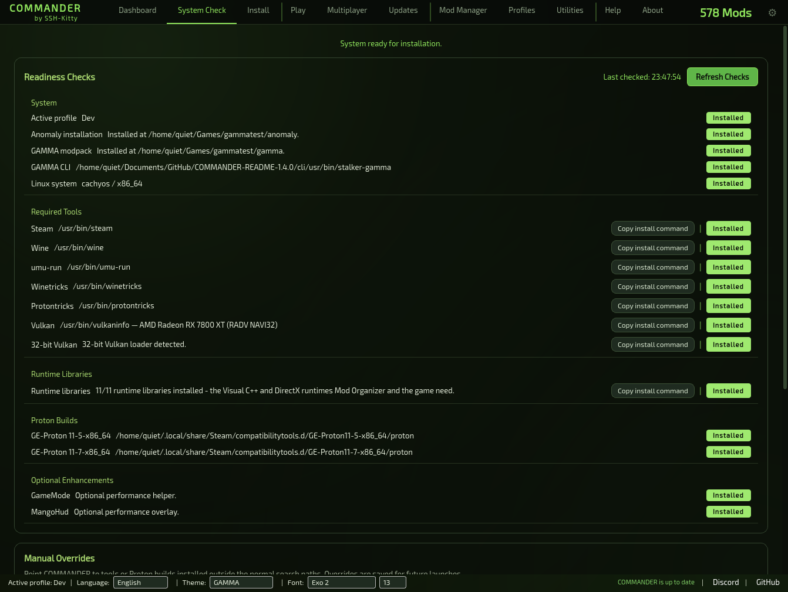

Checks every dependency GAMMA and MO2 need: the CLI, Wine, Winetricks, Protontricks, `umu-run`, Vulkan (including the
32-bit loader), each Winetricks runtime, GE-Proton builds, GameMode and MangoHud. Every check shows its status and a
copyable install command for your distro, and manual overrides let you point COMMANDER at tools in non-standard places.

</details>

<details>
<summary><b>Utilities</b></summary>
<br>

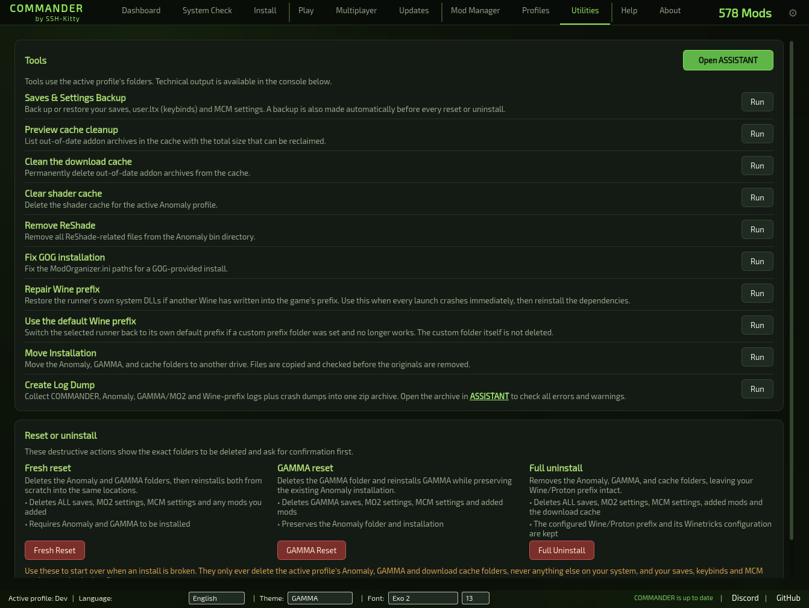

- **Cache cleanup.** Preview which archives are out of date and how much space they free, then clean them.
- **Clear shader cache** and **Remove ReShade** for a clean slate after driver or mod changes.
- **Fix GOG installation** repairs `ModOrganizer.ini` paths for a GOG copy of Anomaly.
- **Repair Wine prefix** restores the runner's own system DLLs if another Wine has written into the game's prefix (the
  symptom: every launch crash-loops and can exhaust system memory). COMMANDER also refuses to launch into a prefix it
  detects as damaged. Reinstall dependencies afterwards.
- **Move installation** copies Anomaly, GAMMA and the cache to another drive, verified before the originals are
  deleted. An interrupted move is detected and resumed on the next launch.
- **Create Log Dump** and **Export Diagnostics** bundle logs, settings and system info into one archive for bug reports.
- **Fresh Reset**, **GAMMA Reset** and **Full Uninstall** show exactly what will be deleted and what's kept before
  doing anything, and back up your saves and settings first. Your Wine prefix always survives.
- Opens the bundled **COMMANDER ASSISTANT** log analyser.

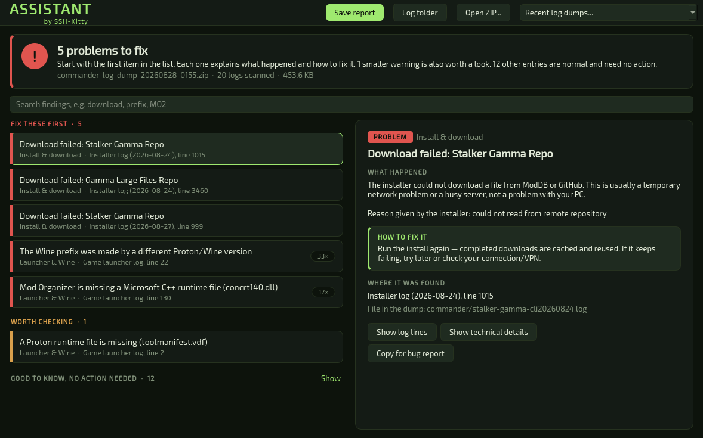

</details>

<details>
<summary><b>Settings</b></summary>
<br>

- **10 languages:** English, French, Spanish, German, Romanian, Polish, Russian, Ukrainian, Portuguese and Turkish.
  Applies instantly, no restart, unless a background task is running.
- **6 themes:** GAMMA, GAMMA Black, Dusk, Midnight, Terminal and Reactor.
- Interface font (6 options) and size (9–22 px), both applied live.
- **COMMANDER build:** stable or unstable.
- Startup page, default runner, "Always use GameMode", an Open Winecfg shortcut, and MO2 display scale presets
  (100–200%) for readable text in Mod Organizer.
- Desktop autostart on login.
- **Add to Steam** writes COMMANDER and Deck Mode into your Steam library as non-Steam games.

</details>

<a id="screens"></a>
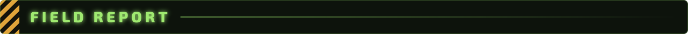

<table>
<tr>
<td width="50%"><a href="docs/readme/screens/multiplayer.png"></a><br><sub>Multiplayer: xrRazom co-op</sub></td>
<td width="50%"><a href="docs/readme/screens/profiles.png"></a><br><sub>Profiles: several installs side by side</sub></td>
</tr>
<tr>
<td width="50%"><a href="docs/readme/screens/install.png"></a><br><sub>Install: live per-addon progress</sub></td>
<td width="50%"><a href="docs/readme/screens/play.png"></a><br><sub>Play: runners, prefixes and launch targets</sub></td>
</tr>
<tr>
<td width="50%"><a href="docs/readme/screens/update.png"></a><br><sub>Updates: every changed addon</sub></td>
<td width="50%"><a href="docs/readme/screens/modmanager.png"></a><br><sub>Mod Manager: GAMMA's categories, drag to reorder</sub></td>
</tr>
<tr>
<td width="50%"><a href="docs/readme/screens/systemcheck.png"></a><br><sub>System Check: every dependency in one place</sub></td>
<td width="50%"><a href="docs/readme/screens/utilities.png"></a><br><sub>Utilities: maintenance and recovery</sub></td>
</tr>
</table>

<a id="install"></a>


### AppImage (recommended)

Download the latest `.AppImage` from [**Releases**](https://github.com/SSH-Kitty/STALKER-GAMMA-COMMANDER/releases).
Unstable builds are marked **Pre-release**.

```bash
chmod +x STALKER-GAMMA-COMMANDER-*-x86_64.AppImage
./STALKER-GAMMA-COMMANDER-*-x86_64.AppImage
```

Python, Qt and the CLI are all bundled inside, and the AppImage updates itself. For a menu entry and icon, use
[Gear Lever](https://github.com/mijorus/gearlever) or [AppImageLauncher](https://github.com/TheAssassin/AppImageLauncher).

### Arch Linux

A `PKGBUILD` is provided under [`packaging/aur/`](packaging/aur/):

```bash
git clone https://github.com/SSH-Kitty/STALKER-GAMMA-COMMANDER.git
cd STALKER-GAMMA-COMMANDER/packaging/aur
makepkg -si
```

### From source

```bash
git clone -b 1.4.0-Unstable https://github.com/SSH-Kitty/STALKER-GAMMA-COMMANDER.git
cd STALKER-GAMMA-COMMANDER
./run.sh
```

`run.sh` creates a `.venv/`, installs PySide6 and launches the app. The `stalker-gamma` CLI is already bundled at
`cli/usr/bin/stalker-gamma`. Add `--deck` to start in [Steam Deck Mode](#steam-deck-mode): `./run.sh --deck`.

<details>
<summary><b>Running several instances and the tests</b></summary>
<br>

**`run.sh` allows several instances at once**, so you can run two builds side by side while developing. Every extra
window says `[extra instance]` in its title bar. They all share `~/.config/stalker-gamma`, so settings writes are
last-write-wins, and nothing stops two of them starting an install into the same folders. Use
`COMMANDER_ALLOW_MULTIPLE=0 ./run.sh` for the shipped behaviour. The AppImage and the AUR package always refuse a second
instance.

```bash
QT_QPA_PLATFORM=offscreen .venv/bin/python -m pytest tests/ -q
```

The Qt platform has to be set on the command line: the suite builds real widgets, and there is no `pytest.ini` to hold
the variable.

</details>

<a id="first-run"></a>
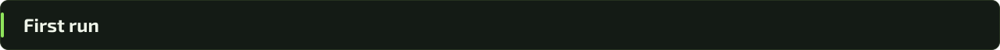

1. **Profiles:** set your Anomaly, GAMMA and cache folders (absolute paths) and create the profile. It activates
   automatically.
2. **Install → Install GAMMA.** Anomaly is installed first if it's missing. Expect a large download: ~150 GB, or
   ~100 GB with Minimal mode.
3. **Install → Install Dependencies** sets up the Wine/Proton runtimes MO2 needs.
4. **Play:** pick a runner and a launch target, then **Launch Game**.

Use **Updates** for addon updates afterwards, and **Verify Integrity** if something seems broken.

> [!TIP]
> Stuck? Open **Help** in COMMANDER for the full documentation, or bundle a report with **Utilities → Create Log Dump**
> and bring it to the [Discord](https://discord.gg/6A9psrtYhh).

<a id="steam-deck-mode"></a>


A second interface built for the Deck's 1280×800 screen, its controls and its touchscreen. Open it from the small Steam
Deck icon on the **Dashboard**, next to *Quick actions*: COMMANDER closes and reopens in Deck Mode. **Exit Deck Mode**,
on Deck Mode's Settings screen (or the ☰ Menu button), brings you back the same way.

- **First-run setup.** With no profile yet, Deck Mode asks one question, internal storage or SD card, creates the
  profile and sends you to Install.
- **Tabs, in handheld order:** Dashboard · Play · Mods · Update · Install · Utilities · System · Settings.
- **Dashboard** answers "can I play?" in one banner with the one button that moves things forward (Play, Install,
  Resume, Update), then Anomaly, GAMMA and dependencies side by side, updates, mods, storage and your profiles, with a
  built-in folder browser for editing them.
- **Play** has **Force Stop Game** for a game that hangs (the Deck has no Alt+F4). **Mods** shows the Mod Manager's
  category tree as a full-screen list. **Update**, **Install**, **Utilities**, **System** and **Settings** do what their
  desktop pages do.
- **Handheld-aware.** The Deck stays awake during installs, updates and moves, you're warned before a long download on
  battery, and the header shows the battery.
- **Any screen size.** On a monitor or a TV, the whole interface scales up with the window.

<details>
<summary><b>Controls</b></summary>
<br>

The controller works in Game Mode out of the box (COMMANDER reads the gamepad directly, so Steam's default layout is
fine) and in Desktop Mode's keyboard layout.

| Button | Action |
|---|---|
| D-pad / left stick | Move (hold to repeat) |
| A | Select / toggle |
| B | Back |
| X | The screen's main action (below) |
| Y | The screen's second action / search |
| L1 / R1 | Previous / next tab |
| L2 / R2 | Page up / down |
| ☰ Menu | Quick menu: Play GAMMA, Exit Deck Mode or Quit |
| ⧉ View | Controls help |

| Screen | X | Y |
|---|---|---|
| Dashboard | What the banner says (Play / Install / Resume / Update) | Re-check |
| Play | Play GAMMA (Force Stop while running) | Open MO2 |
| Mods | Category menu | Search |
| Update | Check / Apply updates | Show changes |
| Install | Install or resume GAMMA | Install dependencies |
| System | Re-check | — |

Text fields have a built-in on-screen keyboard (Y), touch works everywhere (tap to select, drag to scroll), and every
screen shows its buttons in the footer. All six themes and ten languages work, and the text size has its own 80–150%
scale.

</details>

<details>
<summary><b>Adding Deck Mode to Steam</b></summary>
<br>

On a real Steam Deck, COMMANDER offers Deck Mode the first time it starts and remembers your answer (change it later
under **Settings → When COMMANDER starts**). In Game Mode it opens Deck Mode without asking.

In Desktop Mode, use **Add COMMANDER to Steam** (desktop **Settings → Steam**, or Deck Mode's **Settings**). It writes
both **STALKER COMMANDER** and **STALKER COMMANDER DECK** into your Steam library. If Steam is running, it is closed,
the shortcuts are written, and Steam starts again. To do it by hand:

- *AUR / from source:* in Desktop Mode, **Add a Non-Steam Game** and pick **STALKER COMMANDER (Deck Mode)**.
- *AppImage:* add the `.AppImage` itself, then set its launch options to `--deck`. An AppImage can only publish one
  desktop entry, so the Deck one can't ride along with it.

Deck Mode full-screens itself under gamescope, which has no window manager to size a window for it.

</details>

<a id="contributing-a-translation"></a>
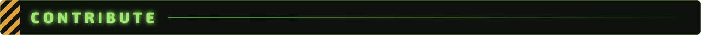

Adding a language needs no code changes: start from
[`commander_gui/locales/template.py`](commander_gui/locales/template.py), which lists every translatable string in the
app, and follow the steps in its header.

Found a bug? [Open an issue](https://github.com/SSH-Kitty/STALKER-GAMMA-COMMANDER/issues) with your COMMANDER version,
your distro, and a log dump from **Utilities → Create Log Dump**. Unstable feedback is especially welcome on the
[Discord](https://discord.gg/6A9psrtYhh).

<a id="credits"></a>
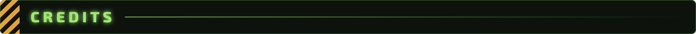

- **[FaithBeam](https://github.com/FaithBeam)**: [`stalker-gamma-cli`](https://github.com/FaithBeam/stalker-gamma-cli),
  the installer this GUI drives and bundles. All installation, download and checksum logic is theirs.
- **[dnttnd](https://github.com/dnttnd)**: testing, dev builds, bug reports and helping polish the UI.
- **[Grokitach](https://github.com/Grokitach)** and the GAMMA team: [the modpack itself](https://github.com/Grokitach/Stalker_GAMMA).
- **The xrRazom team**, for xrRazom Co-op.
- **[GSC Game World](https://www.gsc-game.com/)** and the Anomaly team, for the game.

<a id="license"></a>


Licensed under the **GNU General Public License v3.0**; see [LICENSE](LICENSE). COMMANDER bundles and drives
`stalker-gamma-cli`, which is GPL-3.0, so this front-end is GPL-3.0 as well.

Copyright for the Python/Qt graphical interface: **SSH-Kitty**.

<div align="center">


<sub>S.T.A.L.K.E.R. G.A.M.M.A. COMMANDER · made with Python, PySide6 and Qt 6</sub><br>
<sub>Not affiliated with GSC Game World or the GAMMA development team.</sub><br>
<sub><i>Good hunting, stalker.</i></sub>

</div>
